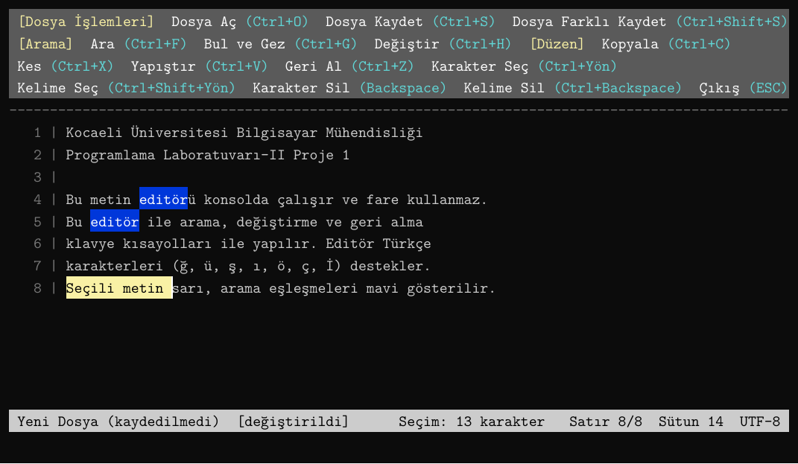
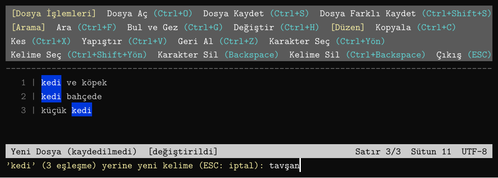
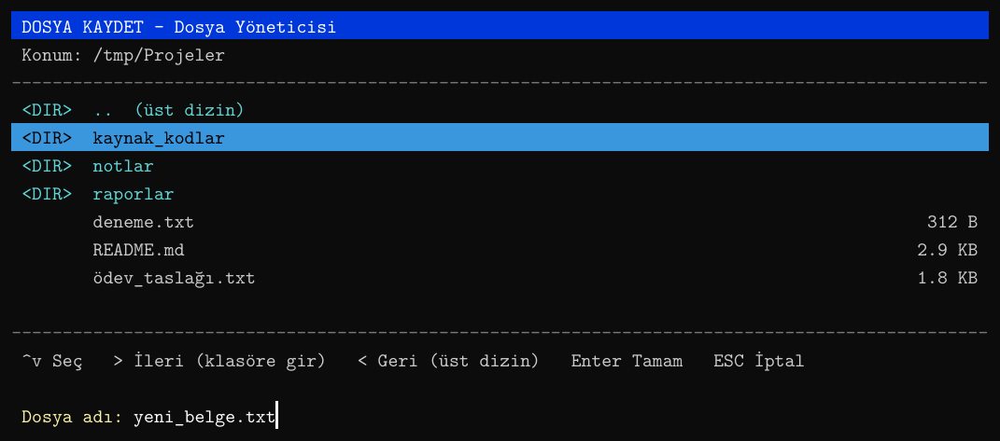

# Mini Notepad++ — Konsol Tabanlı Metin Editörü

Notepad++'ın temel özelliklerini konsola taşıyan, **fare kullanmadan yalnızca klavye kısayollarıyla** yönetilen bir metin editörü.
Python ile yazıldı ve **yalnızca standart kütüphane** kullanılıyor: konsol, Windows API'sine `ctypes` ile doğrudan erişilerek ve ANSI/VT kaçış dizileriyle yönetiliyor.

> Kocaeli Üniversitesi Bilgisayar Mühendisliği — Programlama Laboratuvarı-II, Proje 1



## Özellikler

- **Toolbox şeridi:** Komutlar yan yana dizilir, kısayollar parantez içinde gösterilir. Satıra sığmayan komutlar alt satıra geçer.
- **Konsol içi dosya yöneticisi:** Dosya Aç / Kaydet / Farklı Kaydet. → ile klasöre girilir, ← ile üst dizine çıkılır.
- **Arama:** Ctrl+F ile eşleşmeler yazdıkça **mavi** vurgulanır. Ctrl+G ile eşleşmeler arasında ← → tuşlarıyla gezilir.
- **Tümünü değiştir:** Ctrl+H ile yapılır, ESC ile iptal edilebilir. Tek Ctrl+Z ile tüm değişiklik geri alınır.
- **Seçim:** Ctrl+Yön ile karakter, Ctrl+Shift+Yön ile kelime bazlı seçim yapılır. Seçili metin **sarı** gösterilir.
- **Düzenleme:** Kopyala, kes, yapıştır (Windows panosuyla senkron) ve kelime kelime çalışan geri alma.
- **Satır numaraları:** Satır eklendikçe ve silindikçe dinamik olarak güncellenir.
- **Türkçe karakter desteği:** AltGr ile yazılan `@ # { } [ ]` karakterleri de dahil.
- **Görünüm:** Yanıp sönen beyaz dikey çizgi imleç; pencere boyutu değişince ekran yeniden düzenlenir.
- **Çıkış:** ESC ile çıkılır; kaydedilmemiş değişiklik varsa `Kaydetmek istiyor musunuz? (y/n)` sorulur.

| Ctrl+H ile değiştirme | Dosya yöneticisi |
|---|---|
|  |  |

## Kısayollar

| Tuş | İşlem |
|---|---|
| `Ctrl+O` | Dosya Aç |
| `Ctrl+S` | Dosya Kaydet (dosya daha önce kaydedildiyse dosya yöneticisi açılmaz) |
| `Ctrl+Shift+S` | Dosya Farklı Kaydet |
| `Ctrl+F` | Ara |
| `Ctrl+G` | Bul ve eşleşmeler arasında gez |
| `Ctrl+H` | Tümünü değiştir |
| `Ctrl+Yön` / `Ctrl+Shift+Yön` | Karakter / kelime bazlı seçim |
| `Ctrl+C` / `Ctrl+X` / `Ctrl+V` | Kopyala / Kes / Yapıştır |
| `Ctrl+Z` | Geri al |
| `Backspace` / `Ctrl+Backspace` | Karakter / kelime silme |
| `ESC` | Önce arama vurgusunu kaldırır, sonra çıkış yapar |

## Kurulum ve Çalıştırma

Gereksinimler: **Windows 10/11** ve **Python 3.8+**. Harici paket gerekmez.

```bat
python main.py
```

**`main.exe` oluşturmak için** `build.bat` dosyasını çalıştırın. Çıktı `dist\main.exe` olarak oluşur. Betik PyInstaller'ı kendisi kurar.

> **Önemli:** Uygulamayı klasik Windows konsolunda çalıştırın:
> ```bat
> conhost python main.py
> conhost dist\main.exe
> ```
> PyCharm, VS Code gibi geliştirme ortamlarının terminalleri ve Windows Terminal; `Ctrl+H`, `Ctrl+Backspace` ve `Ctrl+Shift+Yön` gibi tuşları programa ulaşmadan kendileri yakalayabilir.

## Proje Yapısı

```
├── main.py           Giriş noktası
├── editor.py         Komutlar, tuş yönlendirme, ekran çizimi
├── buffer.py         Metin veri yapısı (TextBuffer)
├── selection.py      Seçimin başlangıç/bitiş indeksleriyle takibi
├── undo.py           Stack sınıfı ve Action (INSERT/DELETE/BATCH) kayıtları
├── search.py         KMP string eşleşme algoritması
├── filemanager.py    Konsol içi dosya yöneticisi
├── console.py        Windows konsol API'si: ham giriş, VT modu, pano
├── keys.py           Tuş olayı sınıfı
├── ansi.py           Renk kodları ve hizalama yardımcıları
├── bench.py          Başarım ölçümleri
├── tus_testi.py      Tanı aracı: tuşların konsola nasıl ulaştığını gösterir
├── build.bat         main.exe üretir
├── tests/            Uçtan uca otomatik testler
├── rapor/            IEEE formatında proje raporu (LaTeX + PDF)
└── docs/images/      Ekran görüntüleri
```

## Veri Yapıları ve Algoritmalar

| Konu | Tercih | Gerekçe |
|---|---|---|
| Metin | Satır listesi → her satır bir karakter listesi | (satır, sütun) erişimi O(1); düzenleme yalnızca o satırı etkiler: O(satır uzunluğu) |
| Geri alma | Özgün `Stack` + işlem kaydı | Metnin kopyası yerine yalnızca yapılan işlem saklanır; ardışık harfler tek kayıtta birleşir |
| Toplu değiştirme | Sondan başa değiştirme + `BATCH` kaydı | Öndeki eşleşmelerin konumu kaymaz; tek Ctrl+Z ile geri alınır |
| Seçim | Doğrusal başlangıç/bitiş indeksi | `idx(r,c) = Σ(satır uzunluğu + 1) + c` |
| Arama | Knuth-Morris-Pratt | O(n + m); uyuşmazlıkta metinde geri gidilmez |
| Çizim | Görünen satırlar için ikili arama (`bisect`) | Çizim süresi eşleşme sayısından bağımsız |

## Test ve Başarım

```bat
python tests\test_editor.py
python bench.py
```

36 uçtan uca test senaryosunun tamamı geçmektedir. Öne çıkan ölçüm sonuçları:

- **Ekleme:** 50.000 satırlık dosyanın ortasına karakter eklemek satır listesiyle **~2,9 µs**, tek parça string ile **~6,8 ms** sürüyor (~2400 kat).
- **Arama:** En kötü durum girdisinde KMP, naif aramadan **~18 kat** hızlı.
- **Geri alma belleği:** 1000 düzenleme için **~90 KB**; her seferinde kopya almak 404 KB'lık dosyada **~809 MB** gerektirirdi.
- **Ekran çizimi:** Arama vurgusu açıkken 50.000 satırda **108,85 ms → 0,32 ms**. Bu iyileştirme ölçümle bulunan darboğazın giderilmesiyle elde edildi.

Ayrıntılar için: [`rapor/rapor.pdf`](rapor/rapor.pdf)

## Bilinen Sınırlamalar

- Yalnızca Windows'ta çalışır (platform katmanı Windows konsol API'sine bağlı).
- Sekme karakterleri 4 boşluğa dönüştürülür.
- İleri alma (redo) yoktur.
- Emoji gibi çift genişlikli karakterler hizalamayı bozabilir.

## Geliştirici

**Burak Kılcı** — [@BurakKilci2000](https://github.com/BurakKilci2000)
